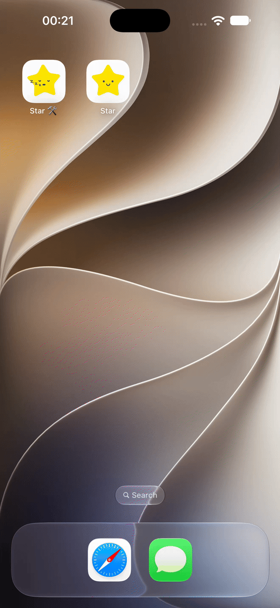
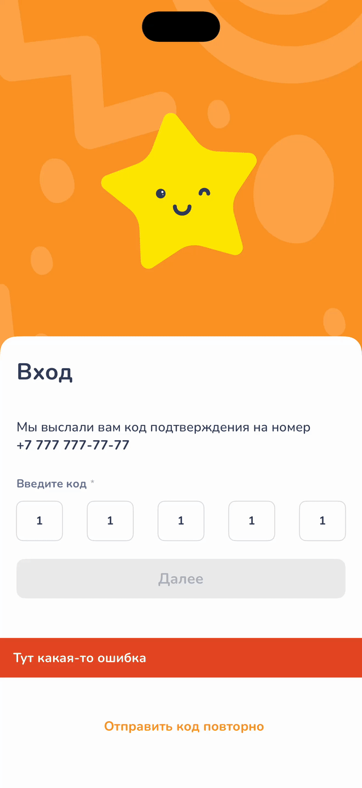

# ⭐ Star

[](#)
[](#)
[](#)
[](#)
[](./LICENSE)
[](#)

Тестовое задание на **SwiftUI** с поддержкой тёмной и светлой темы, анимацией переходов, локализацией и бесшовной авторизацией через **silent push**.

<picture>
  <source media="(prefers-color-scheme: dark)" srcset="Readme/DarkEn.gif">
  <source media="(prefers-color-scheme: light)" srcset="Readme/LightEn.gif">
  
</picture>
&nbsp;&nbsp;&nbsp;
<picture>
  <source media="(prefers-color-scheme: dark)" srcset="Readme/DarkRu.gif">
  <source media="(prefers-color-scheme: light)" srcset="Readme/LightRu.gif">
  
</picture>

## ⚙️ Требования
- Разработать форму ввода телефона с автоматической вставкой `+7` в начале
- Анимация движения звезды при переходе на следующий экран
- Отображение ошибки при вводе неверного кода
- Поддержка тёмного оформления

## 🛠 Технологии
- **SwiftUI** — декларативный UI-фреймворк, весь интерфейс приложения построен на нём
- **Swift** — язык разработки, активно используются современные возможности
- **MVVM** — разделение UI и бизнес-логики: View рендерит состояние, ViewModel (`ObservableObject`) управляет логикой и отдаёт готовые данные через `@Published`
- **Matched Geometry Effect** — плавные переходы между экранами с сохранением геометрии элементов
- **Silent Push** — тихая доставка SMS-кода в приложение без подтверждения пользователя
- **Localization** — поддержка нескольких языков через строковый каталог `Localizable.xcstrings`
- **Logging** — централизованное логирование для отладки сетевых запросов и жизненного цикла экранов
- **Combine** — реактивные потоки: таймеры обратного отсчёта, обработка событий и связывание `@Published`-свойств с UI
- **async / await** — все сетевые запросы на структурированной конкурентности: `Task`, `TaskGroup`, отмена при уходе с экрана
- **Tinted Icon** — иконка с поддержкой tint color: корректно перекрашивается под тему и акцентный цвет системы
- **Dark Mode** — поддержка светлой и тёмной темы: цвета заданы через ассеты с Any/Dark Appearance, UI перестраивается автоматически

## 📦 Установка
```bash
git clone https://github.com/your-org/star-project.git
cd star-project
open StarProject.xcodeproj
